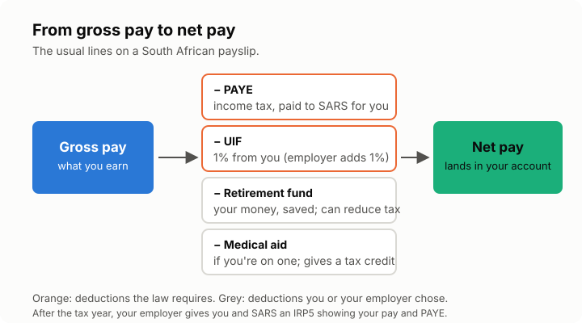

# Lesson 2: Reading your payslip
<!-- facts: none -->

## By the end, the learner can

- Name the usual deductions on a South African payslip and say what each one is.
- Explain what PAYE is and why most employees owe little or nothing at filing time.
- Say what an IRP5 is and where to find it.

## Key ideas

**Gross pay** is what you earn before deductions. **Net pay** is what lands in your account.

**PAYE** (Pay As You Earn) is income tax your employer takes from each payslip and pays to SARS
for you. It is an estimate of your yearly tax, spread over the months.

**UIF** (Unemployment Insurance Fund) takes 1% from you and 1% from your employer, capped. It pays
out if you lose your job, go on maternity leave or fall ill. It is not a tax refund.

**Other common deductions:** pension or provident fund contributions, medical aid, and sometimes
union fees. These are your money going somewhere, not tax; some reduce your tax (lesson 4).

**IRP5** is the certificate your employer gives you (and SARS) after the tax year, showing what
you earned and how much PAYE was paid. SARS uses it to pre-fill your return.

## Why filing still matters

PAYE is an estimate. If you had two jobs, left a job mid-year, pay a retirement annuity privately,
or have medical costs, the real figure can differ. Filing settles it: you get a refund or owe the
difference.

## Exercise

Ask the learner to look at a payslip (theirs, or an example) and name each line. Remind them not
to share their actual amounts or tax number with you.

## Sources

- [SARS: Pay-As-You-Earn](https://www.sars.gov.za/types-of-tax/pay-as-you-earn/)
- [UIF, Department of Employment and Labour](https://www.labour.gov.za/)
